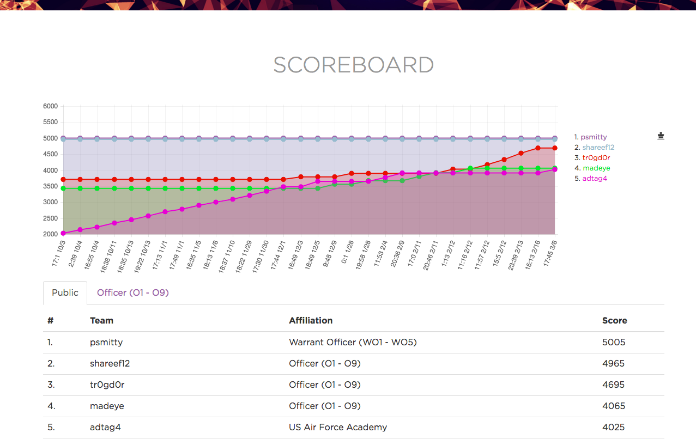
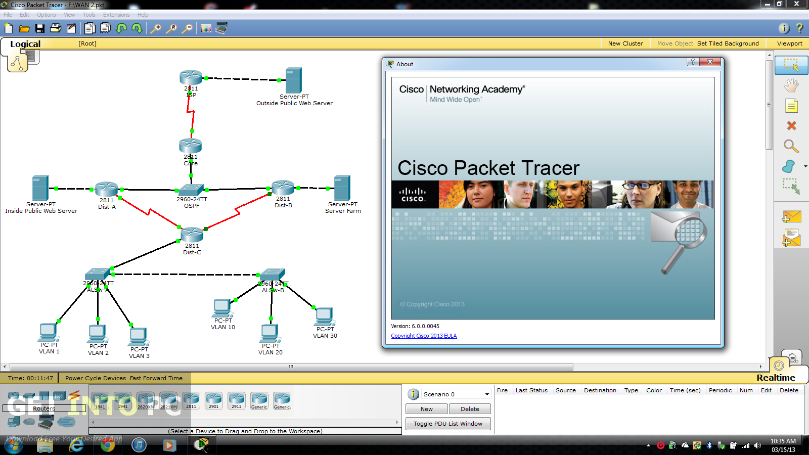
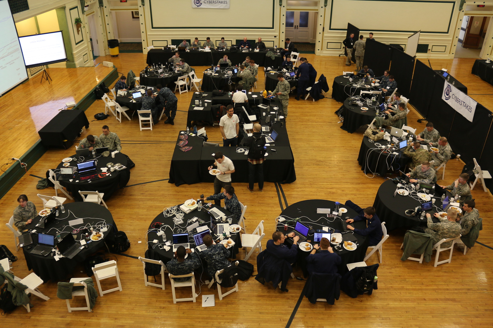
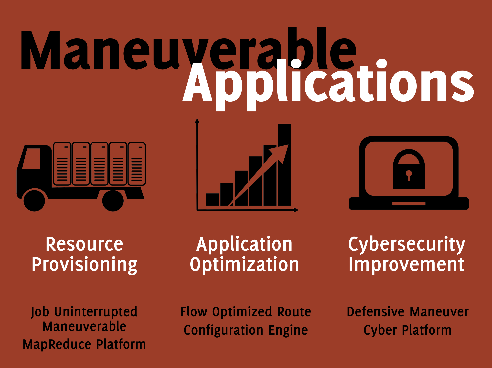
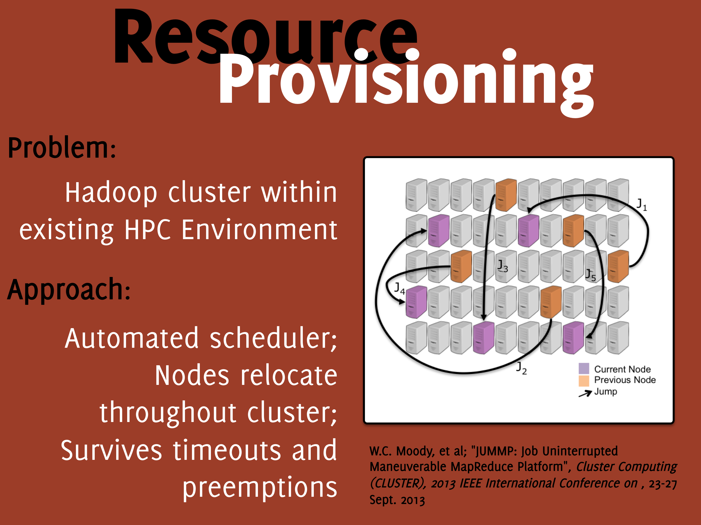
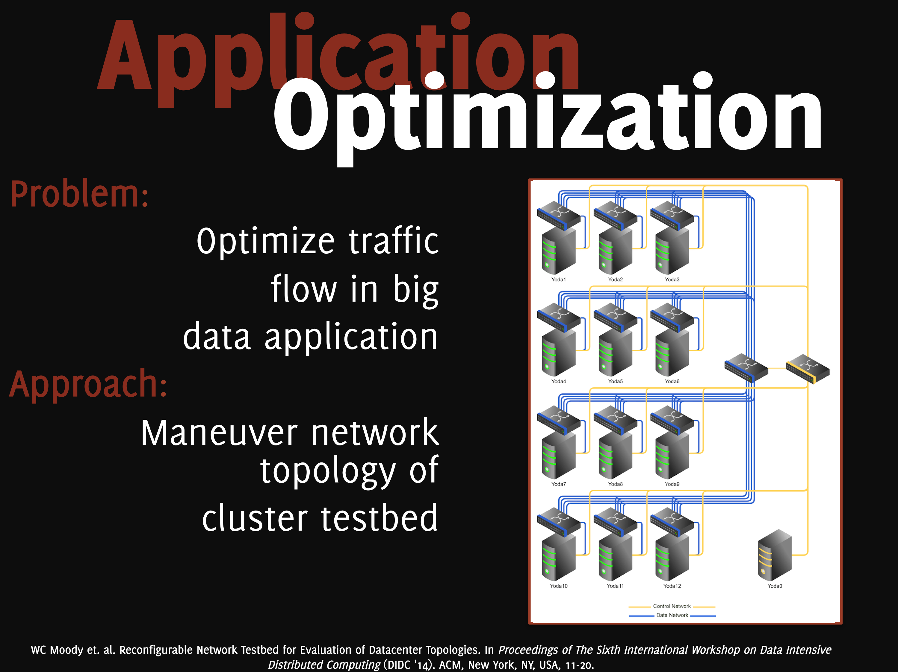
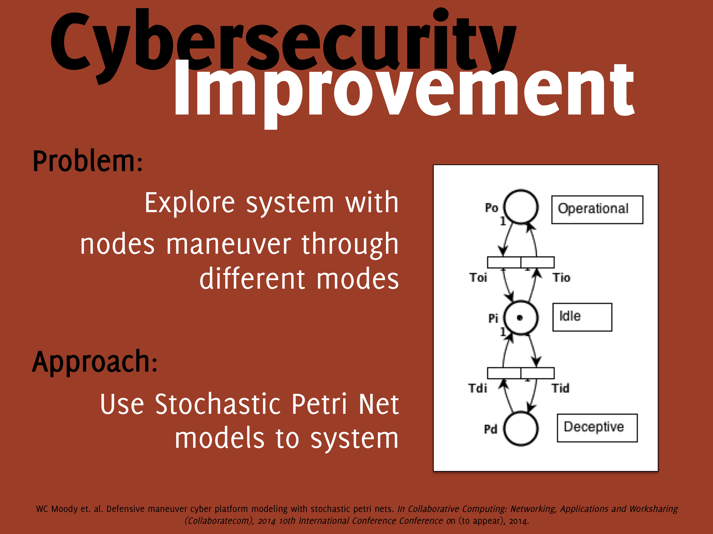

When I wrapped up my time in academia, my research was focused on _cybersecurity education_. We focused on how gamification could be used to increase understanding of cyber security concepts. Specifically, we explored how **capture-the-flag exercises** could expose middle school, high school, and undergraduate students to basic concepts of computer science, networking, and computer security.

{: .center}
{:height="75%" width="75%"}

Additionally, I was involved in a study of using _virtualization platforms_ combined with physical lab environments to learn **network engineering and design**. We conducted a semester-long study of students taking an intermediate-level networking course at an undergraduate institution. We studied learning proficiency, timing, and general excitement and interest in these environments.

{: .center}
{:height="75%" width="75%"}

Lastly, I led two senior capstone projects to build _cyber ranges and cyber weapons platforms_ for use in education and cyber security competitions.

{: .center}
{:height="75%" width="75%"}

* * * 

My disseration research interests lie in the area of _Cyber Maneuver_, specifically _maneuverable applications_. The Department of Defense defines _maneuver_ as

A movement to place ships, aircraft, or land forces in a position of advantage 
  over the enemy.

I researched how to design, model, and build maneuverable applications. A maneuverable application is distributed and parallel applications that takes advantage of the addition and removal of resources within the application, giving the perception of movement. These resources can be computation, network, storage, or applications themselves. 

{: .center} 
{:height="50%" width="50%"}
 
The preceived movement of the maneuverable application is deliberate and skillful with the desire to gain system advantages. Some of those advantages that I am researching are as follows:

*   Provisioning Resources
*   Optimizing Applications
*   Improving Cyber Security

{: .center} 
{:height="50%" width="50%"}

In the area of resource provision, my work with JUMMP has shown how a maneuverable application can be used to provided MapReduce programming within a shared resource.  

In the area of application optimization, my work with an SDN testbed has shown how maneuvering datacenter computing racks to different positions in the topology can improve shuffle traffic transfer times in MapReduce  

{: .center} 
{:height="50%" width="50%"}  

Finally, in the area of cybersecurity, I am working toward building a PetriNet model of a system that continously maneuvers between computation, idle, and deception states to add moving target defense and deceptive defense.  

{: .center} 
{:height="50%" width="50%"}

